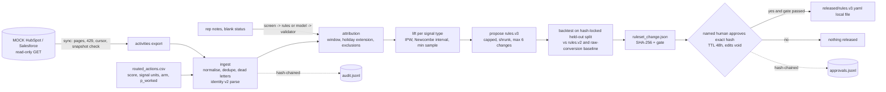

# ARCHITECTURE

Status labels: **implemented and tested locally** unless marked **mocked** (connector source) or **designed** (real connectors, PR release).



```
sources -> sync/ingest -> attribute -> lift -> propose -> backtest -> change set -> HUMAN -> release (file)
                                   (deterministic, no AI)                           ^ only AI step: note -> outcome code,
                                                                                      validated, with deterministic fallback
```

## Components

| Module | Role | Notes |
|---|---|---|
| `sofl/identity.py` | host parse and account resolution | v2 parse order; v1 kept in `evals/v1_parse.py` as baseline |
| `sofl/ingest.py` | messy CSV to records | dead-letter reasons; duplicates and conflicting duplicates; column mismatch |
| `sofl/connector.py` | read-only pull from a MOCK source | no write verbs; checkpoint truncation; snapshot check |
| `sofl/attribution.py` | label each routed action | exclusions first-match; `window_open` is not a negative |
| `sofl/lift.py` | per-type lift and band check | IPW with 1/p_worked, Kish n, Newcombe interval |
| `sofl/reweight.py` | rules.v3 proposal and naive baseline | change only if old implied lift is outside the 80 percent interval |
| `sofl/backtest.py` | weighted AUC, capture at 30 percent, paired bootstrap | explore rows weigh 1/p_worked |
| `sofl/changeset.py` | assembles and hashes the change set | deterministic content |
| `sofl/approval.py` | approve, verify, release | the only code that writes a rules file |
| `sofl/disposition.py` | the only AI step | screen, model, validator, fallback |

## Feedback-loop and selection-bias design

1. Every row records `arm` (routed, holdout, explore) and `p_worked`, the probability it would be worked.
2. Holdout: a random share of qualifying rows is withheld from reps. It gives the routed-versus-held-out check by score band and is a precondition for any proposal.
3. Explore: a random share of below-threshold rows is routed anyway. Without it, every estimate is conditioned on the old rules having routed the row (the loop would only ever learn about what it already believed).
4. Lift uses only rows reps were asked to work, weighted by 1/p_worked. Rows nobody worked and nobody sampled have no outcome in the export; they are counted (`unobserved_below_threshold_not_exported` in `data/SPLIT.json`) and represented through the explore weights, not assumed to be zero.
5. The estimate is intention to treat: rep action is reported but not used as a label.

## Known limits

Marginal lift lets co-occurring signals share credit. Recency decay is not re-tuned. Windows are per config, not per segment. The simulation knows the truth because I wrote it.
